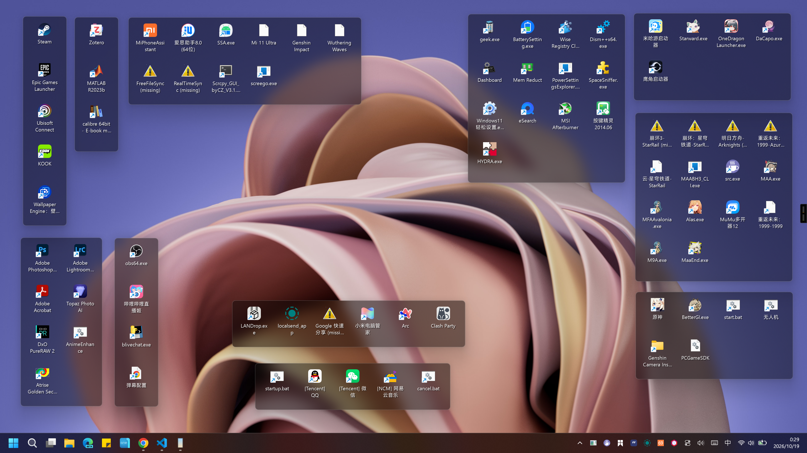

# NoFences

Didn't want to pay 11€, made my own.



## Build

NoFences is a 64-bit Windows Forms application targeting **.NET Framework 4.8**.

### Prerequisites

- Windows
- Visual Studio 2022 Build Tools (or Visual Studio) with the **MSBuild** component
- The **.NET Framework 4.8 targeting pack**. In Visual Studio Installer, select it under **Individual components**. Alternatively, install the [.NET Framework 4.8 Developer Pack](https://aka.ms/msbuild/developerpacks).

### Build the executable

From the repository folder, run in PowerShell:

```powershell
.\build.ps1
```

The script checks for MSBuild and the .NET Framework 4.8 targeting pack before building. If PowerShell blocks running the script, use:

```powershell
powershell -ExecutionPolicy Bypass -File .\build.ps1
```

The Release executable is created at `NoFences\bin\Release\NoFences.exe`.

### Run

The target computer needs the **.NET Framework 4.8 runtime**. It is separate from the targeting pack used to build the application; install the runtime if it is not already available on the computer.

## Display scaling

The app opts into Per-Monitor V2 DPI awareness. Fence contents, resize hit areas, and image thumbnails scale with monitor DPI, and the custom-rendered text uses grid-fitted anti-aliasing. When moving a fence between monitors, its on-screen content updates to the new scale; saved window positions and sizes retain the existing format.

## System tray

NoFences provides a notification-area icon with **New fence**, **Advanced settings**, and **Exit** actions. Double-click the icon to open Advanced settings. The settings window includes global display controls and the fence data folder; existing fence-specific options remain in each fence's right-click menu.

## Global appearance settings

Open **Advanced settings** from the tray menu to change the global title size (16-100 logical pixels) or hide all fence title bars and title text. The global size overrides each fence's saved title size without changing those saved values. When titles are hidden, hold **Alt** and drag a fence to move it; resize its edges as usual. The **Modify all** action in Advanced settings is a one-time operation: it adjusts each fence's outer bounds to fit its current thumbnail columns and rows, preserving the current column count, then saves the new bounds.

## Fence data recovery

NoFences loads its original XML fence metadata as well as JSON fence data stored in the newer `Fences\<id>\fence.json` layout and XML metadata in `Backup_XML_*` folders. Alternate-format sources are read without being changed. If a saved file or folder path no longer exists, the item remains visible with a warning icon and a “(missing)” label instead of disappearing from its fence. Right-click the missing item to locate a replacement file or folder, remove the item from the fence, or open its containing folder when that folder still exists.

Removing a fence deletes its saved metadata in the XML and JSON locations and matching recovery-backup records, preventing deleted fences from being restored from an older copy at the next startup.

## Moving and sorting fence items

Drag a thumbnail to a new position in its fence to change its saved order, or drag it onto another unlocked fence to move it there. Drag files and folders from File Explorer onto a fence to add them; these drops add references and do not move the original files.